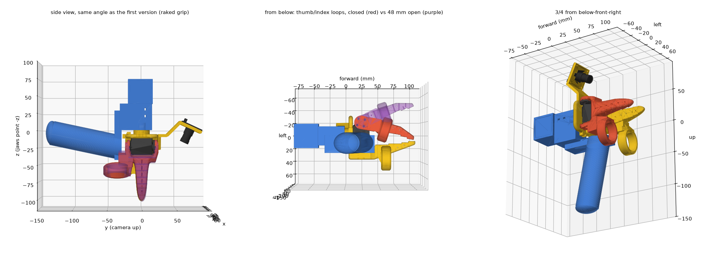

# SO-101 UMI

UMI-style data collection for the SO-101 arm. A handheld copy of the SO-101's own
gripper records demonstrations, and the policy trained on them runs on an SO-101
follower. Also includes a gripper for kinesthetic teaching on an SO-101 leader arm.

> **Status:** designed and checked in CAD only. Nothing has been printed or tested on
> hardware yet.

## Start here

- **How to set it all up:** [`docs/umi-setup.md`](docs/umi-setup.md). Covers what's different
  from real UMI, tags, cameras, recording, turning demos into robot data, the overhead-camera
  problem and masking, grip force, kinesthetic teaching, and the arm's limits.
- **What to print:** [`cad/README.md`](cad/README.md)
- **Kinesthetic teaching on a leader arm:** [`cad/kinesthetic_leader/README.md`](cad/kinesthetic_leader/README.md)
- **Camera viewer:** [`viewer/README.md`](viewer/README.md)

## Folders

| Path                      | What's in it                                                                                                                                                                               |
| ------------------------- | ------------------------------------------------------------------------------------------------------------------------------------------------------------------------------------------ |
| `cad/`                    | Printable STLs for the handheld (handle, two jaw-with-loop parts, camera mount, fit-test coupon), the ArUco tag sheet PDF, renders, a 3D preview (`.glb`) and the CAD check results        |
| `cad/kinesthetic_leader/` | The 3 parts that turn an SO-101 leader arm into a hand-guided arm with a real gripper and wrist camera, plus an offline 3D viewer                                                          |
| `cad/src/`                | Python scripts that build the parts, run the checks and make the tag sheet                                                                                                                 |
| `stock_umi/`              | The original Stanford UMI gripper for reference: its official Cura 3MF print files, the same parts as STLs, its tag PDFs and print settings. Doesn't fit the SO-101 as-is (see its README) |
| `calibration/`            | Printable checkerboards (9×6 inner corners, 25 mm squares, A4 and Letter) for camera calibration, and the script that makes them                                                           |
| `docs/`                   | The setup guide                                                                                                                                                                            |
| `viewer/`                 | A browser page for viewing and recording the connected cameras                                                                                                                             |
| `data/`                   | Captures saved by the viewer                                                                                                                                                               |

The SO-101 gripper geometry comes from
[TheRobotStudio/SO-ARM100](https://github.com/TheRobotStudio/SO-ARM100) (Apache-2.0).
