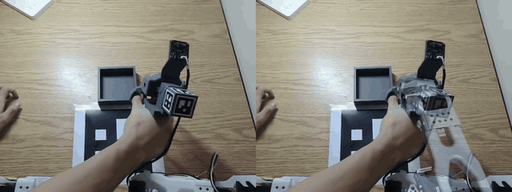

# SO-101 UMI

UMI-style data collection for the SO-101 arm. A handheld copy of the SO-101's own
gripper records demonstrations, and the policy trained on them runs on an SO-101
follower.

> **Status:** printed and in use. Demos are recorded on a two-arm SO-101 bench, converted to joint
> plans, and replayed on the real arm. This repo has the hardware, calibration, demo estimation
> (gripper pose + jaw opening) and trajectory optimization; recording and robot drivers are up to you.


[](docs/media/demo.mp4)

_Recording a demo, seen from the overhead camera (2× speed). [Full video](docs/media/demo.mp4)._

## Install

```bash
git clone https://github.com/CodCodingCode/so101-umi.git && cd so101-umi
uv venv --python 3.12 && uv pip install -r requirements.txt   # or: pip install -r requirements.txt
```

Rebuilding the printed parts needs a few more packages: `cad/requirements.txt`.

## Start here

- **How to set it all up:** [`docs/umi-setup.md`](docs/umi-setup.md). Covers what's different
  from real UMI, tags, cameras, recording, turning demos into robot data, the overhead-camera
  problem and masking, grip force, and the arm's limits.
- **What to print:** [`cad/README.md`](cad/README.md). The overhead camera sits on The Robot Studio's
  [overhead camera mount](https://github.com/TheRobotStudio/SO-ARM100/tree/main/Optional/Overhead_Cam_Mount_Webcam)
  (STLs also in `sim/assets/vendor/robotstudio_overhead_mount/`).
- **Calibrate your rig:** [`calibration/README.md`](calibration/README.md). Our rig's results are in
  `calibration/example/` to start from.
- **How a handheld demo becomes a real-arm motion (every step):** [`umi/README.md`](umi/README.md#the-full-process-handheld-demo--real-arm)

## Folders

| Path                      | What's in it                                                                                                                                                                                                                                                                     |
| ------------------------- | -------------------------------------------------------------------------------------------------------------------------------------------------------------------------------------------------------------------------------------------------------------------------------- |
| `cad/`                    | Printable STLs for the handheld (handle, two jaw-with-loop parts, camera mount, fit-test coupon), the ArUco tag sheet PDF, renders, a 3D preview (`.glb`) and the CAD check results                                                                                              |
| `cad/src/`                | Python scripts that build the parts, run the checks and make the tag sheet                                                                                                                                                                                                       |
| `calibration/`            | Checkerboards (9×6 inner corners, 25 mm squares, A4 and Letter), the lens calibration script, and `example/`: the reference rig's calibration results. Your own results are written here and git-ignored                                                                         |
| `umi/`                    | Demo → trajectory (`convert.py`: gripper pose + jaw opening), trajectory → SO-101 joint plan with safety checks and trajectory optimization (`to_robot.py`, `trajopt.py`), and the handheld's calibrations (`cube_calib.py`, `pivot_calib.py`, `table_touch.py`). See its README |
| `grip/`                   | Squeeze reflex for the gripper: replayed jaw angles touch an object without squeezing it, so this keeps the servo pushing once the jaw stops on something (`reflex.py`, plus a sim check). See its README |
| `sim/`                    | MuJoCo twin of the two-arm SO-101 bench (Menagerie SO-101 model, calibrated cameras), used by the `umi/` conversions. See its README                                                                                                                                             |
| `docs/`                   | The setup guide and the demo video (`media/`)                                                                                                                                                                                                                                    |
| `data/`                   | Captures and episodes (git-ignored)                                                                                                                                                                                                                                              |

The SO-101 gripper geometry comes from
[TheRobotStudio/SO-ARM100](https://github.com/TheRobotStudio/SO-ARM100) (Apache-2.0). For the original
Stanford UMI gripper, see the [UMI project page](https://umi-gripper.github.io/) and the official
[UMI hardware guide](https://docs.google.com/document/d/1TPYwV9sNVPAi0ZlAupDMkXZ4CA1hsZx7YDMSmcEy6EU/edit?usp=sharing).

## Contributing

Issues and PRs welcome, see [CONTRIBUTING.md](CONTRIBUTING.md).

## License

[Apache-2.0](LICENSE): the code, the SO-UMI parts, docs and example calibration.
Third-party files keep their own terms, listed in [NOTICE](NOTICE): the SO-101 model and overhead mount in
`sim/assets/vendor/` (Apache-2.0, see each `LICENSE`).
