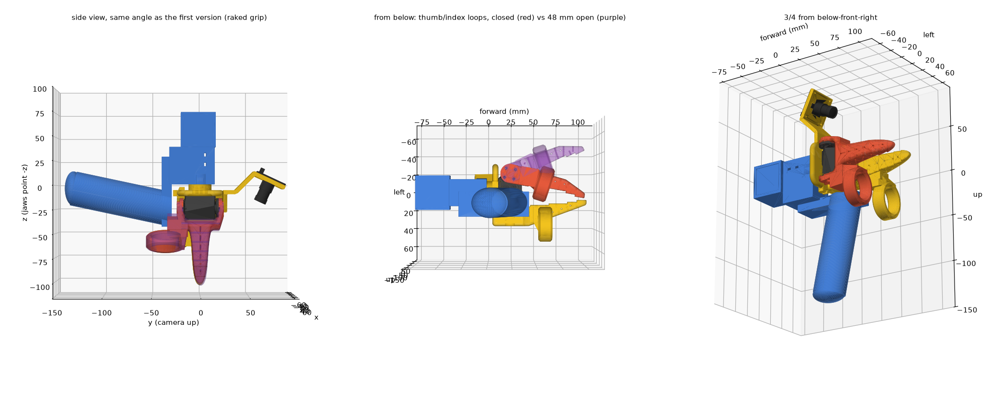
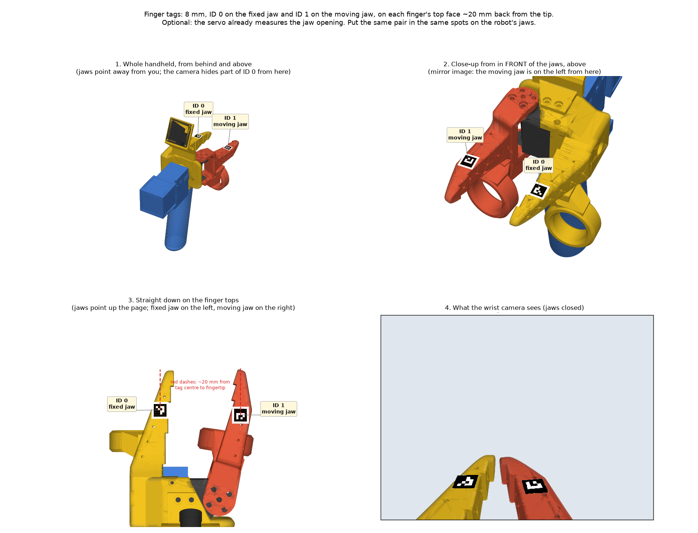
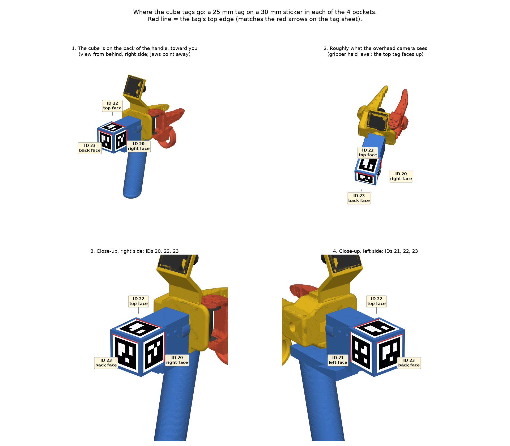

# SO-UMI handheld gripper (v0.4 "pinch")

A handheld copy of the SO-101 gripper for UMI-style data collection. It reuses the
robot's own gripper parts, so the camera-to-jaw geometry is the same on the
handheld and on the arm. Only the handheld uses the loop versions of the jaw parts;
the robot keeps its stock parts.



## How you hold it

- Hold it like a pistol: the grip hangs under the gripper body, raked back 12° (same
  shape and angle as the first version). Camera on top, jaws pointing forward.
- Middle, ring and little finger wrap the grip. Thumb and index go forward from the top
  of the grip, one on each side of the gripper, through the two loops (like rings).
  Squeeze them together to close the jaws; spread them to open.
  - Right hand: thumb in the left loop (fixed jaw), index in the right loop (moving jaw).
  - Left hand: the other way round.
- Reach: the loop centres are 17 mm in front of the grip's front face, and about 58 mm
  from the web of your hand (thumb side).
- The loop centres are 42 mm apart when the jaws are closed and 64 mm apart at a 48 mm
  opening, so 22 mm of pinch travel covers the normal range.
- The moving loop sits straight ahead of the hinge at mid-stroke, so it travels almost
  purely sideways, in the pinch direction (within ±2 mm forward/back). No up/down or
  forward/back finger motion is needed.
- Your hand stays out of the wrist camera's image: everything under the jaws is hidden
  behind the gripper (checked below).

## Files

| File                                     | Print?                                  | What it is                                                                                                            |
| ---------------------------------------- | --------------------------------------- | --------------------------------------------------------------------------------------------------------------------- |
| `soumi_fit_test_horn_plate.stl`          | **print first** (~10 min)               | The handle's mating face only. Checks the 4 screw holes and the 1 mm lip before you print the full handle.            |
| `soumi_handle.stl`                       | yes                                     | Horn-replica plate + neck + pistol grip (30 × 36 mm, 105 mm, raked 12°) under the body + 36 mm ArUco cube on the back |
| `soumi_fixed_jaw_loop.stl`               | yes, instead of the wrist-roll follower | Official SO-101 wrist-roll follower (fixed jaw + servo cage), unchanged, with a finger loop fused under the jaw       |
| `soumi_moving_jaw_loop.stl`              | yes, instead of the moving jaw          | Official SO-101 moving jaw, unchanged, with a finger loop fused under it                                              |
| `SO-ARM101_camera_wrist_mount.stl`       | yes, unchanged                          | Same camera mount as on the arm                                                                                       |
| `soumi_assembly_preview.glb`             | no                                      | Colored 3D assembly; opens in Quick Look                                                                              |
| `soumi_preview.png`, `check_report.json` | no                                      | Renders and the clearance checks                                                                                      |

The original Stanford UMI gripper (which doesn't fit the SO-101 as-is) is on the
[UMI project page](https://umi-gripper.github.io/) and in the official
[UMI hardware guide](https://docs.google.com/document/d/1TPYwV9sNVPAi0ZlAupDMkXZ4CA1hsZx7YDMSmcEy6EU/edit?usp=sharing).

All STLs are in mm. The official meshes come from TheRobotStudio/SO-ARM100 (Apache-2.0).

## Strength

- Each loop: 24 × 28 mm oval hole (big enough for a thumb), 6 mm walls, 14 mm deep,
  rounded edges.
- Each loop is fused into its official part through a solid boss: 580 mm³ (moving jaw)
  and 830 mm³ (fixed jaw) of overlap. The moving-jaw boss sits below the servo-horn
  screw holes, so those screws stay reachable.
- The weakest link is the 4 M3 screws holding the gripper to the handle. Self-tapping
  is fine for normal use; for hard squeezing use heat-set inserts (`PILOT_D = 4.2`).

## Jaw reading

- The real STS3215 sits inside, just as on the robot. Read its position over the bus
  with torque off: these are the same units as the robot's gripper joint.
- No return spring is needed, because your fingers drive the jaw both ways.

## Checks that passed (in CAD, not on a printer)

- The new loop parts never touch the gripper body, servo, camera mount, camera or
  handle, from fully closed (-0.17 rad) to 1.2 rad open. (The stock SO-101 meshes have
  the jaw touching its servo horn by <2 mm³; that's not from these parts.)
- The handle doesn't overlap the gripper body, servo, camera mount or camera. The
  smallest gap between the moving parts and the handle is 3.7 mm (jaws fully closed).
  The two loops never get closer than 5.3 mm.
- Neither the loops nor the handle appear in the wrist camera's 640×480 image. A
  fingertip poking out the front of either loop falls inside the frame area but is
  completely hidden behind the jaws.
- Each printed part is a single solid.

## Hardware

- 4× M3×12 screws (fixed-jaw part → handle). They go in from inside the servo cage and
  self-tap into the 2.7 mm pilot holes.
- 1× STS3215 plus the usual horn screws, same as the robot gripper. A leader-ratio
  servo (1/147) is much easier to back-drive by pinching than a follower-ratio one (1/345).
- ArUco tags (all DICT_4X4_50), as described in "ArUco tags" below.
- Zip ties for the camera USB and servo cables through the neck slots.

## ArUco tags



Finger tags (optional): ID 0 on the fixed jaw and ID 1 on the moving jaw, each on the flat top
face of the finger (the side the wrist camera looks at), ~20 mm back from the tip. Same spots
on the robot's jaws.

What the real UMI does (from its code: `example/calibration/aruco_config.yaml`,
`scripts/calibrate_gripper_range.py`, `umi/common/cv_util.py::get_gripper_width`):

- **Finger tags:** one 16 mm DICT_4X4_50 tag on each finger: ID 0 left, ID 1 right
  (the next gripper uses 6 and 7). Both sit in the wrist camera's view, about 72 mm
  away. Gripper width is the x-distance between the two tags.
- **Table tag:** one 16 cm tag (ID 13) taped to the table. At the start of a session it
  ties the SLAM map to the table frame.

On SO-UMI:

| Tag       | Where                                                                                               | Size                                                                            | Needed?                                                             |
| --------- | --------------------------------------------------------------------------------------------------- | ------------------------------------------------------------------------------- | ------------------------------------------------------------------- |
| ID 0      | Fixed jaw: top edge of the finger blade (the face the wrist camera sees), ~20 mm back from the tip  | **8 mm** (black square incl. border; the face is only ~9–11 mm wide)            | Optional: the servo already measures the jaw width                  |
| ID 1      | Moving jaw: same spot                                                                               | 8 mm                                                                            | Optional                                                            |
| IDs 20–23 | The 30 mm pockets on the back cube (left, right, top, back faces), orientation printed on the sheet | **25 mm** tag on a 30 mm white sticker (fits the pocket; tracking size = 25 mm) | **Yes**: this is how the overhead camera tracks the handheld's pose |
| ID 13     | Flat on the table, or a ChArUco board                                                               | 16 cm                                                                           | **Yes**: defines the table/world frame for the overhead camera      |



Cube tags, as you hold it (camera on top, jaws pointing away). The red line in the picture
and the red arrow on the sheet mark each tag's top edge:

- **ID 20:** right face (moving-jaw side), top edge toward the jaws
- **ID 21:** left face (fixed-jaw side), top edge toward the jaws
- **ID 22:** top face (camera side), top edge toward the jaws
- **ID 23:** back face (toward you), top edge up

A second handheld needs its own cube IDs (for example 24–27); they're not on the sheet yet.

Notes:

- Put the same finger tags in the same spots on the robot's jaws too, so the wrist
  images look the same on the handheld and the robot (UMI does this as well).
- The finger tags are ~90 mm from the camera and ~42 px across in a 640×480 image.
  That's plenty for detection with exposure locked and the image in focus.
- The moving jaw's tag stays fully in frame up to about a 50 mm opening. Beyond that
  it leaves the image (narrow lens, not a fisheye), so use the servo reading as the
  width source and the tags only as a cross-check.
- UMI's `get_gripper_width` assumes symmetric fingers (if only one tag is seen it
  doubles its offset) and a 72 mm tag depth. Neither holds here: use `nominal_z≈0.09`,
  require both tags, and subtract the fixed closed-jaw offset.
- Don't reuse IDs 0–19 on the cube; UMI's config reserves them.
- **Printable sheet:** `soumi_aruco_tags_letter.pdf` (US Letter; also fits A4). Print at
  100% / Actual size and check its 100 mm scale bar with a ruler. Page 1 has the finger
  tags (4 of each) and two cube sets with which way up each goes; page 2 has the table tag.
  `src/tag_sheet.py` regenerates it, and `src/tag_view.py` regenerates the placement image.

## Assembly order

1. Screw the fixed-jaw part onto the handle (4× M3×12 from inside the cage), **before** the servo goes in.
2. Install the STS3215 in the cage the same way as on the robot.
3. Mount the moving-jaw part on the servo horn, at the same horn position as on your robot.
4. Bolt on the camera mount and camera exactly as on the arm.

## Printing

- Handle: PETG or PLA+, 5 walls, 30–40% gyroid. Lay it on its side with tree supports;
  the screw holes and horn disc must come out clean.
- Both jaw parts: PETG or PLA+, 5 walls, 50% infill. Strongest if the loop's hole points
  straight up (the part stands on end), because then every layer is a complete ring. If
  that orientation prints badly, print the part the usual way and add 1–2 extra walls.

## Things to tune

- **Fit to your hand** in `src/build.py`:
  - `LOOP_Y` and `LOOP_Z` set the loop height and how far forward the loops sit.
  - `RI_X` and `RI_Y` set the hole size.
  - `GRIP_TOP`, `RAKE` and `GRIP_LEN` set the grip position, angle and length.
- The thumb has the longer reach (~58 mm from the web of the hand to the loop centre).
  If your thumb can't get through comfortably, move `GRIP_TOP` forward (more negative z)
  or move the loops back (`LOOP_Z`). Re-run the checks: the closed moving loop is 3.7 mm
  from the grip front.
- **Check your servo's horn first:** the horn hole pattern comes from the CAD mesh. If you
  change the horn plate, print the fit coupon before the full handle.

## Rebuild

```bash
uv venv .venv --python 3.12 && uv pip install --python .venv/bin/python -r requirements.txt
cd src && ../.venv/bin/python build.py .. && ../.venv/bin/python render.py ..
```

`src/asm.py` reads the official SO-101 meshes from `sim/so101_twin/assets/so101_official/`
next to this repo (`robots/sim/...`). Anywhere else, set `SO101_OFFICIAL_DIR` to a folder holding
`so101_new_calib.xml` and `assets/` from
[TheRobotStudio/SO-ARM100](https://github.com/TheRobotStudio/SO-ARM100).

Other scripts in `src/`:

- `arm_sweep.py`: checks whether the finger loops would hit the SO-101 arm anywhere in its joint ranges (also needs `mujoco`).
- `tag_sheet.py OUT.pdf`: regenerates the tag sheet (also needs `opencv-contrib-python`).
- `tag_view.py OUT_DIR TAG_MM`: writes `OUT_DIR/wrist_view_tags.png`, the wrist camera's view of the finger
  tags (saved here as `tag_placement_wrist_view.png`; also needs `opencv-contrib-python`).
- `tag_cube_view.py OUT_DIR`: regenerates `tag_placement_cube.png` (also needs `opencv-contrib-python`).
- `finger_tag_view.py OUT_DIR`: regenerates `tag_placement_fingers.png` (also needs `opencv-contrib-python`).
- `finger_tag_patches.json`: where the finger tags sit on the jaws (used by the two finger-tag scripts).
