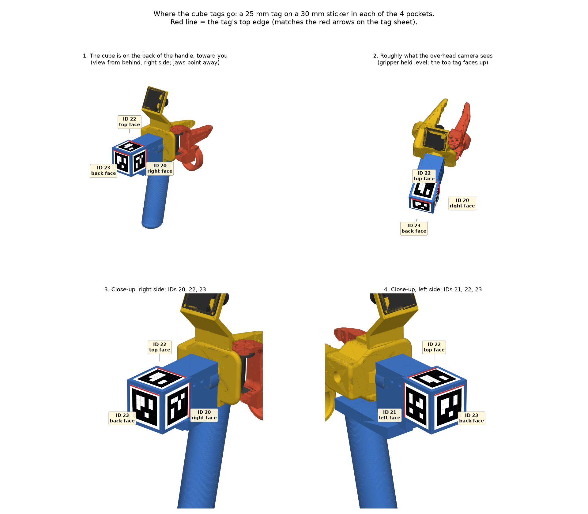

# Setting up UMI on the SO-101 (SO-UMI)

How to collect UMI-style demonstrations with a handheld copy of the SO-101 gripper and
train a policy that runs on an SO-101 follower arm. Also covers the overhead-camera
problem and grip force.

> **Status:** printed and in use. Demos are recorded with the handheld, converted to joint plans
> and replayed on a real SO-101. Numbers marked _estimate_ are calculations, not measurements.

## 1. What UMI is, and what SO-UMI changes

[UMI](https://umi-gripper.github.io/) (Chi et al., 2024) has two halves: a handheld gripper you
carry around to record demonstrations, and a matching setup on the robot that runs the
learned policy. The rule that matters most: **the camera-to-finger geometry must be
identical on the handheld and the robot.**

| Real UMI                                          | SO-UMI                                                                     | Why                                                                                                    |
| ------------------------------------------------- | -------------------------------------------------------------------------- | ------------------------------------------------------------------------------------------------------ |
| GoPro with a ~155° fisheye lens and side mirrors  | The SO-101's own wrist camera (640×480, ~61° horizontal) on its own mount  | Same camera on both sides. A GoPro (~150–200 g) is too heavy for the SO-101 wrist                      |
| Custom handheld gripper; WSG-50 gripper on robot  | The SO-101's own follower gripper parts, with finger loops on the handheld | The robot already has the matching gripper, so there is nothing to copy                                |
| ORB-SLAM3 visual-inertial SLAM for the 6-DoF pose | Overhead camera tracks an ArUco cube on the handle, against a table tag    | A narrow, rolling-shutter camera with no IMU makes SLAM fragile. SO-101 demos happen on a table anyway |
| ArUco tags on the fingers measure jaw width       | A real STS3215 inside the handheld, read over the bus with torque off      | Same units as the robot's gripper joint. Finger tags become an optional cross-check                    |
| Time-sync step between GoPros                     | Every camera and servo plugs into one laptop                               | One clock, so no sync step                                                                             |

## 2. What to print and buy

Full details are in [`../cad/README.md`](../cad/README.md). Per handheld (one per hand):

| Item                                   | Notes                                                                                                               |
| -------------------------------------- | ------------------------------------------------------------------------------------------------------------------- |
| `cad/soumi_fit_test_horn_plate.stl`    | **Print first** (~10 min). Checks the 4 screw holes and the lip before you print the full handle.                   |
| `cad/soumi_handle.stl`                 | Pistol grip + horn plate + ArUco cube                                                                               |
| `cad/soumi_fixed_jaw_loop.stl`         | Official follower gripper body + fixed jaw, with a thumb/index loop fused on                                        |
| `cad/soumi_moving_jaw_loop.stl`        | Official moving jaw, with a loop fused on                                                                           |
| `cad/SO-ARM101_camera_wrist_mount.stl` | Same camera mount as on the robot                                                                                   |
| 1× STS3215 servo                       | The leader-ratio version (1/147, C046) is much easier to pinch than the follower one (1/345, C001). Check the label |
| Servo bus board + power supply         | For reading the handheld servo. A spare, or borrow one from an arm you aren't using                                 |
| Wrist camera                           | **The same model** as on the robot                                                                                  |
| 4× M3×12 screws, zip ties              | Screws self-tap into 2.7 mm pilots. Use heat-set inserts (`PILOT_D = 4.2`) for hard squeezing                       |
| Tag sheet                              | `cad/soumi_aruco_tags_letter.pdf`                                                                                   |

Print in PETG or PLA+ with 5 walls. The robot side needs nothing new: keep its stock
follower gripper and the same camera mount.

## 3. ArUco tags

All tags are `DICT_4X4_50`. Print the sheet at **100% / Actual size** and check its 100 mm
scale bar with a ruler.

| Tag       | Where                                                       | Size                               | Needed?                                                     |
| --------- | ----------------------------------------------------------- | ---------------------------------- | ----------------------------------------------------------- |
| IDs 20–23 | The four 30 mm pockets on the handle's back cube            | 25 mm tag on a 30 mm white sticker | **Yes**: the overhead camera tracks the handheld with these |
| ID 13     | Flat on the table                                           | 160 mm                             | **Yes**: defines the table (world) frame                    |
| ID 0      | Fixed jaw: top edge of the finger, ~20 mm back from the tip | 8 mm                               | Optional: the servo already measures width                  |
| ID 1      | Moving jaw: same spot                                       | 8 mm                               | Optional                                                    |

Which cube face gets which tag, and which way up, is listed in
[`../cad/README.md`](../cad/README.md#aruco-tags) and printed on the sheet.

- If you use finger tags, put the same tags in the same spots on the **robot's** jaws too,
  so wrist images match (UMI does this).
- Don't reuse IDs 0–19 on the cube; UMI's config reserves them.
- UMI's `get_gripper_width` assumes symmetric fingers and a 72 mm tag distance. Neither
  holds on the SO-101: use `nominal_z ≈ 0.09`, require both tags, and subtract the fixed
  closed-jaw offset. Past ~50 mm opening the moving-jaw tag leaves the frame, so use the
  servo as the width source.

## 4. Cameras and calibration

- **Same camera, same mount, same settings** on handheld and robot.
- Record the **wrist cameras at 640×480 MJPEG, 30 fps**. Raw YUV over USB 2.0 can drop frames.
- Record the **overhead camera at a higher resolution (1080p if it has it)**. It's a tracker,
  measuring 25 mm tags about 1 m away. At 640×480 (focal length ≈ 543 px) a tag is only
  ~14 px across, and the cube sits ~156 mm behind the jaw tip, so 1° of orientation noise
  moves the computed tip ~2.7 mm. More pixels per tag means a steadier pose. Its resolution
  doesn't need to match anything: at deployment the robot's pose comes from its joint angles.
  - Check that the 1080p mode doesn't widen or crop the view. Hold the cube at working
    distance and count tag pixels in each mode.
  - Quick test: set the handheld still on the table, record ~10 s, and look at how much the
    computed jaw tip jitters. Under ~1 mm is good.
- Put each camera on its own USB port or controller. Three USB 2.0 webcams on one hub can fail
  to start for lack of bandwidth.
- **Calibrate each lens at exactly the mode you record in.** 640×480 is often a crop or a
  different sensor mode, so a 1080p calibration won't carry over (and vice versa).
- **Lock exposure and white balance** to the same values on both sides. Keep exposure short
  and the room bright: a cheap rolling shutter smears fast moves, and blurred tags mean
  frames with no pose.
- **Overhead camera:** calibrate its lens, then find its pose from table tag ID 13. Measure
  where each robot base sits relative to tag 13, so handheld poses can be expressed in each
  robot's base frame.

## 5. Recording demos

1. Wire the handheld servo to its bus board with **torque off**, and plug in the wrist camera.
   Zip-tie both cables through the neck slots and run them along your forearm.
2. Log, on the laptop's clock: wrist-camera frames, overhead frames, the cube pose from the
   overhead camera, and the handheld servo position.
3. Gripper pose = cube pose × the fixed cube-to-gripper transform from the CAD (the cube's
   position in the gripper frame is in `cad/src/build.py`).
4. **Stay inside the arm's reach**: about 40 cm from where the robot base would be.
   Outside it, the planner holds the arm at the nearest pose it can safely reach and flags
   those frames.
5. **Stand behind where the robot base would be** and keep the gripper pointing out from that
   spot, not swinging in from the side. This cuts the frames the arm can't reach, and it keeps your
   forearm where the robot's arm will be.
6. Move at a pace the follower can repeat. Fast moves blur the tags and leave gaps in the pose.

**Do this before printing everything:** hold just a camera and a cube, walk through the task,
and run IK on the recorded poses. If most frames are reachable, the plan works. If not,
you've found the real problem early.

## 6. Turning demos into robot data

1. Convert each frame's gripper pose into the robot's base frame.
2. Run SO-101 inverse kinematics per frame. The SO-101 has **5 joints** (pan, shoulder,
   elbow, wrist pitch, wrist roll), so the gripper can only point within the vertical plane
   through the arm's base. Frames the arm can't reach are held at the nearest safe pose and
   flagged (`umi/to_robot.py`; every step is in [`umi/README.md`](../umi/README.md)).
3. Use the handheld servo reading directly as the gripper action. It is in the same units
   as the robot's gripper joint, as long as both are calibrated the same way.
4. Write a normal LeRobot dataset in joint space: wrist images, joint-angle states and
   next-frame joint actions. To LeRobot it looks like a teleop dataset, so stock ACT or
   Diffusion Policy trains on it unchanged.
5. **Replay every demo on the follower** before training, to check the arm can keep up.

## 7. The overhead camera problem

> **Recommended: use the overhead camera for tracking only.** The tag detector only looks for
> the cube and table tags; your arms and body in the shot don't matter unless they cover the
> cube. The policy is trained on the wrist cameras plus gripper poses (and, for two arms, the
> pose between the grippers, as UMI does), and never sees an overhead image. Then nothing
> below applies. Read on only if you want the overhead image as a policy input.

The wrist camera is clean: the CAD check found the handle, the loops and your fingers are
never visible in its 640×480 image. The overhead camera is the problem. During collection
it sees **you** holding two handhelds, with no robot arms. At deployment it sees **two robot
arms** and no human. Real UMI avoids this by using wrist cameras only.

Options, simplest first:

1. **Wrist cameras only** (UMI's choice). The downside: the SO-101 camera is narrow (~61°),
   so the policy sees much less of the scene than UMI's fisheye does.
2. **Replay and re-record.** Replay each demo on the follower and record the overhead
   camera again. The scene must be reset exactly and the replay must
   succeed, so this suits slow tasks.

Also:

- **Two-handed setups:** each wrist camera can see the _other_ hand during collection and
  the other robot arm at deployment, so those images won't match.
- Keep your head and body out of the overhead view, or crop the image to the workspace.

## 8. Grip force

The stock jaws are rigid, and the handheld only records the jaw angle. Touching an object
and squeezing it give the same reading, so a policy trained on this data closes until
contact and never squeezes. Fixes:

- **Soft fin-ray fingertips** on both handheld and robot (what UMI uses). Squeezing then
  shows up as extra closing and in the image.
- **Relabel the data:** when the jaw stops short of closed, set the target a few mm tighter.
- **Force sensors:** most accurate, most expensive and fiddly.

## 9. What the arm can handle (_estimates_)

- **Reach:** about 40 cm from the base.
- **Speed:** each joint tops out around 4–5 rad/s with no load.
- **Weight:** keep fast-moving objects to roughly 100–130 g. A half-full 500 ml bottle
  (~265 g) uses most of the motors' strength just to hold it.
- **Voltage:** the follower's 7.4 V servos give ~45% more torque and ~25% more speed at
  7.4 V than at 5 V. Check that your driver board accepts 7.4 V.

**Good showcase tasks** (light, fast, timing- or feel-based): ball-in-a-cup, two-arm toss
and catch with a soft 10–20 g ball, a ping-pong trick shot into a cup, cup stacking, a
bottle half flip (small bottle about a third full), button pressing on a phone or game
console, USB-C or battery insertion. **Avoid:** heavy objects, tasks that depend on
squeezing hard, and tasks that need full 6-DoF wrist orientation.

Film a teleop attempt next to it and time both, and smooth the policy's output between
action chunks.

## Sources

- UMI: [project page](https://umi-gripper.github.io/), [code](https://github.com/real-stanford/universal_manipulation_interface)
  (tag conventions from `example/calibration/aruco_config.yaml`, `scripts/calibrate_gripper_range.py`,
  `umi/common/cv_util.py`)
- SO-101 meshes: [TheRobotStudio/SO-ARM100](https://github.com/TheRobotStudio/SO-ARM100) (Apache-2.0)
- LeRobot SO-101 docs: [huggingface.co/docs/lerobot/so101](https://huggingface.co/docs/lerobot/so101)
