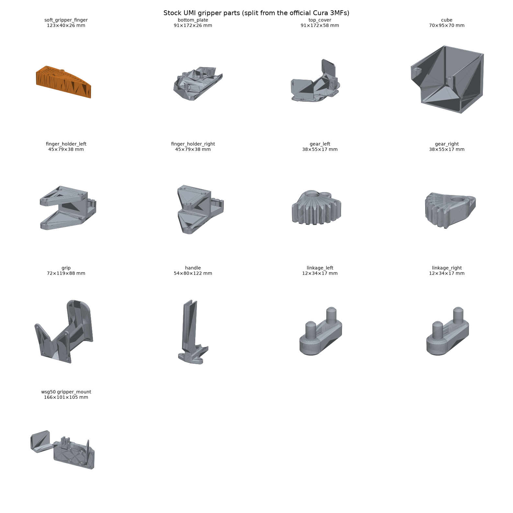

# Stock UMI gripper (reference copy)

The original [UMI](https://umi-gripper.github.io/) handheld gripper and robot mount from Stanford
(Chi et al., RSS 2024), downloaded from the links in the official
[UMI Hardware Guide](https://docs.google.com/document/d/1TPYwV9sNVPAi0ZlAupDMkXZ4CA1hsZx7YDMSmcEy6EU/edit?usp=sharing)
on 2026-11-14.

> **This does not fit the SO-101 as-is.** UMI's robot side needs a parallel-jaw gripper
> (the guide uses a Weiss WSG-50) on a 6–7 joint arm (UR5e or Franka), carrying a GoPro with a
> fisheye lens add-on. The SO-101 has one swinging jaw, 5 joints and too little strength for a
> GoPro at full reach. For the SO-101 use the parts in [`../cad/`](../cad/), which keep UMI's
> method with the SO-101's own gripper and camera. See [`../docs/umi-setup.md`](../docs/umi-setup.md).
> These files are here for reference, or for a bigger arm with a parallel gripper.

## Files

| Folder       | What's in it                                                                                                                                                   |
| ------------ | -------------------------------------------------------------------------------------------------------------------------------------------------------------- |
| `print_3mf/` | UMI's own Cura project files, unchanged. They hold the parts placed on the bed with UMI's print settings (made for a Creality Ender-3 S1 with a 0.6 mm nozzle) |
| `stl/`       | The same parts split out of those 3MFs as one STL per part, in the same print orientation, in mm                                                               |
| `tags/`      | UMI's ArUco tag PDFs (US Letter): one sheet per gripper, plus the table tag                                                                                    |

The source CAD is on Onshape (public; exporting needs a free Onshape account):

- [UMI gripper](https://cad.onshape.com/documents/a8a98201374f5cc9c6538790)
- [Soft finger](https://cad.onshape.com/documents/c8d06048fc2e425772f2749c)
- [WSG-50 to UR5 mount](https://cad.onshape.com/documents/fea49753b2350f8700f47815)
- [WSG-50 to Franka mount](https://cad.onshape.com/documents/10e70b8dbf6f9fe17c716739) (only on Onshape, not in the 3MFs)

Videos: [3D printing](https://youtu.be/EJmAg1Bnp-k), [gripper assembly](https://youtu.be/x3ko0v_xwpg).

## What to print (one handheld gripper)

| Part                  | File                                                          | Qty    | Material | Notes from the guide                         |
| --------------------- | ------------------------------------------------------------- | ------ | -------- | -------------------------------------------- |
| Bottom plate          | `stl/gripper_covers/bottom_plate.stl`                         | 1      | PLA+     |                                              |
| Top cover             | `stl/gripper_covers/top_cover.stl`                            | 1      | PLA+     |                                              |
| Grip                  | `stl/gripper_internals/grip.stl`                              | 1      | PLA+     | 100% infill, 1.8 mm walls                    |
| Handle                | `stl/gripper_internals/handle.stl`                            | 1      | PLA+     |                                              |
| Cube                  | `stl/gripper_internals/cube.stl`                              | 1      | PLA+     | Its tags are unused by UMI's code (optional) |
| Finger holder, left   | `stl/gripper_internals/finger_holder_left.stl`                | 1      | PLA+     | Needs supports                               |
| Finger holder, right  | `stl/gripper_internals/finger_holder_right.stl`               | 1      | PLA+     | Needs supports                               |
| Gear, left / right    | `stl/gripper_internals/gear_left.stl`, `gear_right.stl`       | 1 each | PLA+     |                                              |
| Linkage, left / right | `stl/gripper_internals/linkage_left.stl`, `linkage_right.stl` | 1 each | PLA+     | 2.4 mm walls, 1.8 mm top/bottom              |
| Soft finger           | `stl/finger/soft_gripper_finger.stl`                          | **2**  | TPU 95A  | 100% infill                                  |

Robot side (only for a UR5 with a WSG-50): `stl/robot_mount_wsg50_ur5/wsg50_ur5_gripper_mount.stl`,
printed in PA6-CF (carbon-fibre nylon).

**Common settings (PLA+):** 0.6 mm nozzle, 0.3 mm layers, 1.2 mm walls, 1.2 mm top/bottom,
20% gyroid infill, 190 °C (eSun PLA+), fan 100%.

**Fingers (TPU 95A):** 0.6 mm nozzle, 0.3 mm layers, 100% lines infill, 255 °C (Polymaker
TPU 95A), fan 0%.

**Robot mount (PA6-CF):** 0.6 mm nozzle, 0.2 mm layers, 270 °C, bed 70 °C for the first layer
then 35 °C (the guide says the hotter first layer is critical for adhesion), fan 0%.

## Other hardware (from the guide's bill of materials)

**Handheld gripper** (~$62 body, ~$11 fingers, ~$298 camera):

- 2× MGN9C linear rail, 150 mm
- M3 screws and nuts: 14× M3×8, 2× M3×12, 4× M3×25, 6× M3×35
- Compression spring: 10 mm OD, 0.7 mm wire, 50 mm free length
- 1× M5 nut, stick-on plastic mirror, Super Lube, double-sided tape
- 3M TB641/GM641 grip tape (1 inch wide) for the fingers
- GoPro Hero9, GoPro Max Lens Mod 1.0, V30 micro SD card (spare batteries for all-day use)

**Robot side, per arm:** UR5e or UR5-CB3, Weiss WSG-50 gripper (€3,875), and a camera system
(~$547): GoPro Hero9, Max Lens Mod 1.0, GoPro Media Mod, Elgato HD60 X capture card, micro-HDMI
to HDMI cable, USB cables.

## Tags

Print at 100% / Actual size. The left and right grippers use **different** tags:
`aruco_gripper_0_letter.pdf` and `aruco_gripper_1_letter.pdf`. The guide's photos show where
each tag goes. `aruco_table_tag_letter.pdf` is the table tag.

## Credit and license

Designed by the UMI authors (Stanford, Columbia, Toyota Research Institute). The UMI code
repository is MIT-licensed. The hardware guide doesn't state a license for the CAD files, so
check with the authors before redistributing these copies publicly. The STLs in `stl/` were
split from the official 3MFs without changing the geometry.
